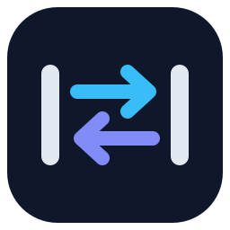
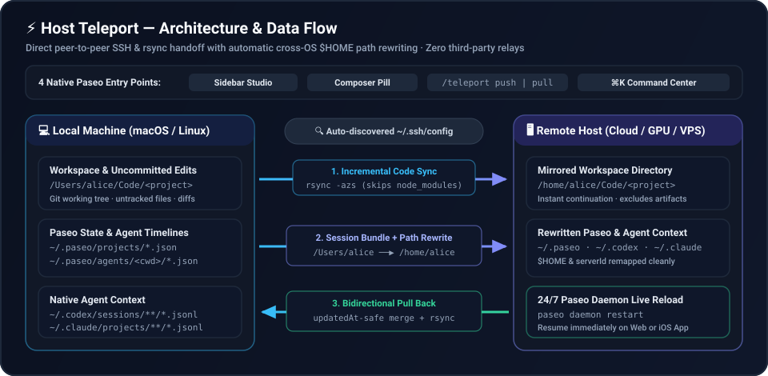

<p align="center">
  
</p>

<h1 align="center">paseo-host-teleport</h1>

<p align="center">
  <strong>Cross-host live workspace, uncommitted code &amp; AI agent session handoff plugin for <a href="https://paseo.sh">Paseo</a>.</strong>
</p>

<p align="center">
  <a href="https://paseo.sh">= 0.16.0" /></a>
  <a href="./LICENSE"></a>
</p>

<p align="center">
  <strong>English</strong> | <a href="./README.zh-CN.md">简体中文</a>
</p>

Start an AI coding session on your laptop, then click **Teleport** before closing the lid to transfer your **uncommitted Git edits, untracked files, Paseo workspace & timeline, and native agent context (Codex / Claude Code)** to a 24/7 remote server, cloud devbox, GPU workstation, or homelab over SSH. When you're back at your desk, pull the latest changes and conversation right back.

---

## ✨ Features

- **Zero-Config SSH Discovery**: Automatically parses host aliases from `~/.ssh/config` and lets you add/remove custom `user@host[:port]` targets, set a default host, and probe SSH connectivity, latency, `rsync`, `paseo`, and remote session counts.
- **Uncommitted Code Sync (`rsync`)**: Incremental transfer (`rsync -azs`) that preserves uncommitted Git diffs and untracked files, safely handles spaces in paths, and skips heavy build artifacts (`node_modules`, `.next`, `dist`, `target`, `.venv`, `__pycache__`, `.DS_Store`).
- **Automatic Cross-OS `$HOME` Path Rewriting**: Seamlessly maps paths between macOS (`/Users/<you>/...`) and Linux (`/home/<you>/...`) across Paseo `projects.json`, `workspaces.json`, `.paseo/agents/*.json`, `.codex/sessions/**/*.jsonl`, and `.claude/projects/**/*.jsonl`.
- **Conflict-Safe Merge**: Merging projects, workspaces, and agent sessions compares `updatedAt` timestamps so pulling from a remote host won't clobber newer local edits.
- **4 Native Paseo Entry Points** (Desktop, Web & Mobile / iOS):
  1. **Sidebar Studio (`Host Teleport`)** — inspect local daemon status, probe SSH targets, manage default/custom hosts, batch push/pull active workspaces, and review transfer history.
  2. **Composer Pill (`Teleport`)** — one-click popover directly inside any agent conversation to push or pull the active workspace & session.
  3. **Slash Command** — `/teleport push [ssh-host]` or `/teleport pull [ssh-host]`.
  4. **Command Center (`⌘K`)** — `Host Teleport: Open Studio`.
- **Timeline Receipt Cards**: Appends a structured transfer receipt card directly to the agent timeline after each push or pull.

---

## 🏗️ How It Works



---

## 📋 Prerequisites

- **Paseo `>= 0.16.0`** on macOS or Linux
- **`ssh`** and **`rsync`** installed on both local and remote hosts
- **`node`** installed on the remote host (auto-detected across standard `PATH`, Homebrew, Volta, and `nvm`)
- **Passwordless SSH authentication** (`ssh <target>` works without interactive password prompts, e.g., via SSH keys or `ssh-agent`)

---

## 📦 Installation

### From GitHub (Recommended)

```bash
paseo plugin add github:jawn-ha/paseo-host-teleport
```

### From a Local Clone

```bash
git clone https://github.com/jawn-ha/paseo-host-teleport.git
cd paseo-host-teleport
paseo plugin add .
```

> **Tip**: Install the plugin on both your laptop and your remote server if you want to trigger Push/Pull from either side (including from the Paseo iOS app).

---

## 🚀 Usage

| Entry Point | How to Trigger | Scope |
| :--- | :--- | :--- |
| **Sidebar Studio** | Click **Host Teleport** in the left sidebar | Manage hosts, probe SSH, push/pull all active workspaces |
| **Composer Pill** | Click **Teleport** below any agent chat input | Push/pull only the current agent's workspace & session |
| **Slash Command** | `/teleport push` or `/teleport pull [host]` | Push/pull the current agent's workspace & session |
| **Command Center** | Press `⌘K` → `Host Teleport: Open Studio` | Open the Studio from anywhere |

---

## 📂 What Gets Synced

| Data | Source / Destination | Path Rewriting |
| :--- | :--- | :--- |
| Workspace code & uncommitted changes | `<project.rootPath>` / `<agent.cwd>` | `$HOME` prefix mapped via `rsync -azs` |
| Paseo projects & workspaces | `~/.paseo/projects/{projects,workspaces}.json` | `rootPath`, `cwd`, `worktreeRoot`, `mainRepoRoot`, `projectKey` (`serverId`) |
| Paseo agent timelines | `~/.paseo/agents/<sanitized-cwd>/*.json` | Directory name & JSON `$HOME` references |
| Native Codex & Claude Code sessions | `~/.codex/sessions/**/*.jsonl`, `~/.claude/projects/**/*.jsonl` | Relative path & JSONL `$HOME` references |

**Default `rsync` excludes**: `node_modules`, `.DS_Store`, `.next`, `dist`, `target`, `.venv`, `__pycache__`.

---

## 🔒 Security & Privacy

- **Direct SSH only**: All code and session transfers happen strictly between your local machine and your own SSH hosts — no third-party servers, cloud relays, or telemetry.
- **Strict input validation**: SSH targets are validated against `^[a-zA-Z0-9._@-]+(?::\d+)?$` and all child processes are invoked via `execFile` (no shell interpolation) with POSIX single-quote escaping for remote paths.
- **Non-blocking execution**: All SSH and `rsync` operations run asynchronously so the Paseo daemon remains responsive during large transfers.

---

## 🛠️ Development

```bash
npm install
npm run typecheck
paseo plugin reload paseo-host-teleport
```

---

## 📄 License

[MIT](./LICENSE) © [jawn-ha](https://github.com/jawn-ha)
