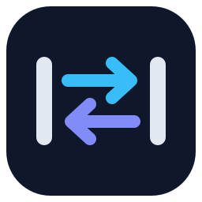
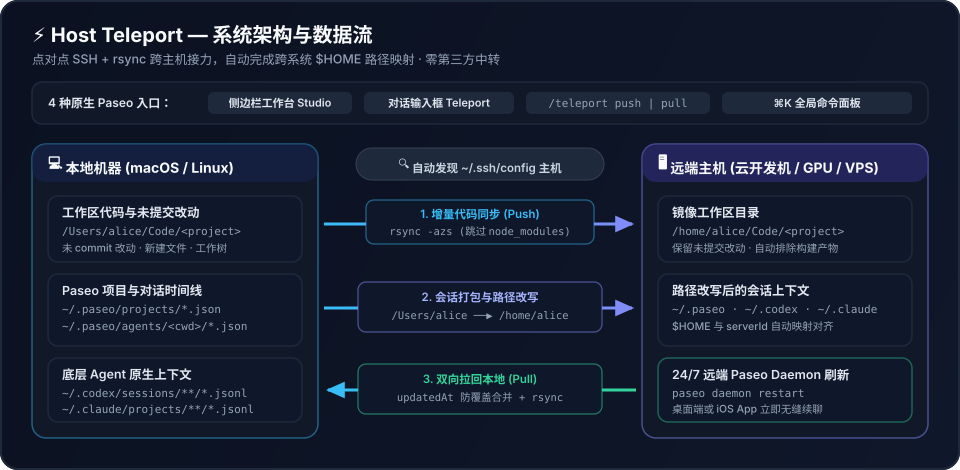

<p align="center">
  
</p>

<h1 align="center">paseo-host-teleport</h1>

<p align="center">
  <strong>面向 <a href="https://paseo.sh">Paseo</a> 的跨主机工作区、未提交代码与 AI Agent 会话无缝接力插件。</strong>
</p>

<p align="center">
  <a href="https://paseo.sh">= 0.16.0" /></a>
  <a href="./LICENSE"></a>
</p>

<p align="center">
  <a href="./README.md">English</a> | <strong>简体中文</strong>
</p>

在笔记本电脑上和 AI Agent 写代码到一半需要合盖离开？点击 **Teleport**，即可通过 SSH 一键将当前**未提交的 Git 改动、新建文件、Paseo 工作区与对话时间线，以及底层 Agent 原生上下文（Codex / Claude Code）**整体迁移到 24 小时在线的云端服务器、开发机、GPU 工作站或家庭 Homelab 继续执行。回到电脑前，再一键拉回最新代码与完整对话记录。

---

## ✨ 核心特性

- **零配置 SSH 主机发现**：自动解析 `~/.ssh/config` 中的主机别名，支持手动增删自定义 `user@host[:port]` 目标、设置默认主机，并可一键探测远端 SSH 连通性、延迟、`rsync`/`paseo` 环境以及远端会话数。
- **未提交代码增量同步（`rsync`）**：基于 `rsync -azs` 高速增量传输，完整保留未 commit 的代码改动与未追踪文件，安全兼容含空格的路径，默认自动排除体积庞大的构建产物（`node_modules`、`.next`、`dist`、`target`、`.venv`、`__pycache__`、`.DS_Store`）。
- **跨系统 `$HOME` 路径自动改写**：自动在 macOS（`/Users/<you>/...`）与 Linux（`/home/<you>/...`）之间映射改写 Paseo `projects.json`、`workspaces.json`、`.paseo/agents/*.json` 以及 `.codex/sessions/**/*.jsonl`、`.claude/projects/**/*.jsonl` 中的路径，迁移后直接无缝续聊。
- **时间戳防覆盖合并**：合并项目、工作区及 Agent 会话时自动对比 `updatedAt` 时间戳，避免拉取远端时误覆盖本地更新的对话。
- **4 种原生 Paseo 入口**（全端支持桌面端、Web 与 iOS App）：
  1. **侧边栏工作台（`Host Teleport`）**：查看本机 Daemon 状态、探测 SSH 主机、管理默认/自定义主机、批量推送或拉取所有活跃工作区、查看最近迁移历史。
  2. **会话输入框按钮（`Teleport`）**：在任意 Agent 对话底部直接呼出快捷弹窗，一键推送或拉取当前工作区与会话。
  3. **斜杠命令**：在输入框直接发送 `/teleport push [ssh-host]` 或 `/teleport pull [ssh-host]`。
  4. **全局命令面板（`⌘K`）**：搜索 `Host Teleport: Open Studio` 随时打开工作台。
- **时间线迁移回执卡片**：每次迁移完成后，自动向当前对话时间线插入一张可视化回执卡片，展示迁移方向、主机、同步数量与耗时。

---

## 🏗️ 工作原理



---

## 📋 环境要求

- macOS 或 Linux 环境下的 **Paseo `>= 0.16.0`**
- 本机与远端主机均已安装 **`ssh`** 和 **`rsync`**
- 远端主机已安装 **`node`**（自动识别标准 `PATH`、Homebrew、Volta 及 `nvm` 路径）
- 已配置 **SSH 免密登录**（`ssh <target>` 无需交互输入密码，例如使用 SSH Key 或 `ssh-agent`）

---

## 📦 安装方式

### 从 GitHub 安装（推荐）

```bash
paseo plugin add github:jawn-ha/paseo-host-teleport
```

### 从本地克隆安装

```bash
git clone https://github.com/jawn-ha/paseo-host-teleport.git
cd paseo-host-teleport
paseo plugin add .
```

> **提示**：建议在本地电脑和远端服务器两端都安装本插件，这样无论在桌面端还是 Paseo iOS 端，都可以随时双向发起 Push / Pull。

---

## 🚀 使用方式

| 入口 | 触发方式 | 同步范围 |
| :--- | :--- | :--- |
| **侧边栏工作台** | 点击左侧边栏 **Host Teleport** | 管理主机、SSH 探测、批量推送/拉取所有活跃工作区 |
| **会话输入框按钮** | 点击任意对话底部的 **Teleport** 按钮 | 仅推送/拉取当前 Agent 所在工作区与会话 |
| **斜杠命令** | 输入 `/teleport push` 或 `/teleport pull [host]` | 推送/拉取当前 Agent 所在工作区与会话 |
| **全局命令面板** | 按 `⌘K` → `Host Teleport: Open Studio` | 任意页面快速打开工作台 |

---

## 📂 同步内容与路径映射

| 数据类型 | 同步路径 | 路径改写规则 |
| :--- | :--- | :--- |
| 工作区代码与未提交改动 | `<project.rootPath>` / `<agent.cwd>` | 通过 `rsync -azs` 按 `$HOME` 相对路径同步 |
| Paseo 项目与工作区配置 | `~/.paseo/projects/{projects,workspaces}.json` | 自动改写 `rootPath`、`cwd`、`worktreeRoot`、`mainRepoRoot`、`projectKey`（含 `serverId`） |
| Paseo Agent 对话时间线 | `~/.paseo/agents/<sanitized-cwd>/*.json` | 自动改写目录名与 JSON 内 `$HOME` 路径 |
| Codex / Claude Code 原生会话 | `~/.codex/sessions/**/*.jsonl`、`~/.claude/projects/**/*.jsonl` | 自动改写相对路径与 JSONL 内 `$HOME` 路径 |

**默认 `rsync` 排除目录/文件**：`node_modules`、`.DS_Store`、`.next`、`dist`、`target`、`.venv`、`__pycache__`。

---

## 🔒 安全与隐私

- **纯点对点 SSH 直连**：所有代码和会话仅在你的本地机器与你自己的 SSH 主机之间直接传输，不经过任何第三方服务器、云端中转或遥测上报。
- **严格输入校验与防注入**：SSH 目标严格校验 `^[a-zA-Z0-9._@-]+(?::\d+)?$`，所有子进程均通过 `execFile` 调用（杜绝命令拼接），远端路径统一采用 POSIX 单引号安全转义。
- **全异步非阻塞**：所有 SSH 和 `rsync` 操作均异步执行，大仓库同步期间不会卡顿或阻塞 Paseo Daemon。

---

## 🛠️ 本地开发

```bash
npm install
npm run typecheck
paseo plugin reload paseo-host-teleport
```

---

## 📄 开源协议

[MIT](./LICENSE) © [jawn-ha](https://github.com/jawn-ha)
